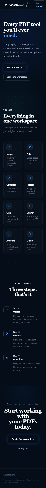
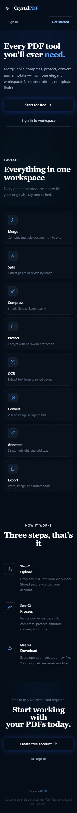

# Mobile landing page verification

The change keeps the existing landing-page artwork and routes while adapting navigation, calls to action, tool cards, section spacing, and the footer to small viewports.

At 320 px the original authentication labels wrapped within a single crowded navigation row. The updated navigation has a separate authentication row; action buttons stack and fill the available width. Tool cards use one column below 360 px and two columns up to the existing `sm` breakpoint.

| Before at 320 px | After at 320 px |
| --- | --- |
|  |  |

## Checks

- `npm ci --offline --ignore-scripts --no-audit --no-fund` using the locked dependency versions and a local npm cache.
- `npm run build`: passed. Existing Browserslist age and large-bundle warnings remain.
- `node node_modules/eslint/bin/eslint.js src/pages/LandingPage.tsx`: passed.
- The production Vite preview was rendered in headless Chromium at widths 320, 375, 390, 640, 768, and 1280 px, with an 850 px viewport height. At every width, document width equaled viewport width, visible content stayed inside the viewport, and all seven navigation/action links had a height of at least 44 px.
- The original component was also checked at the same widths. It already had no horizontal page overflow; this change improves spacing, wrapping, and interaction targets.

Screenshots use reduced motion, disabled animations/transitions, and blocked external font requests. The before image uses an isolated entry point for the original landing component; the after image uses the full production frontend. Backend operations, physical devices, and Safari were not tested. AI assistance was used for implementation and verification.
