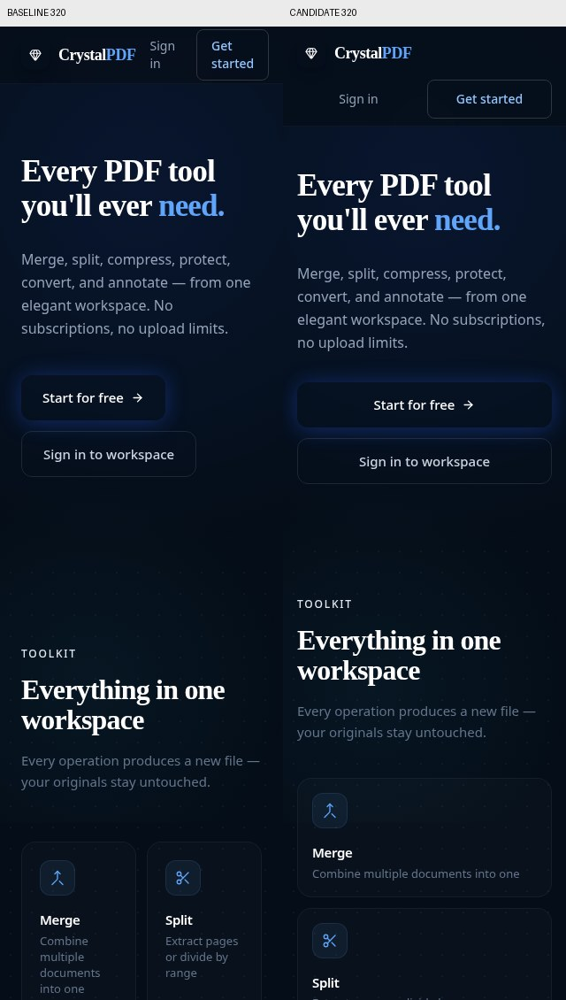
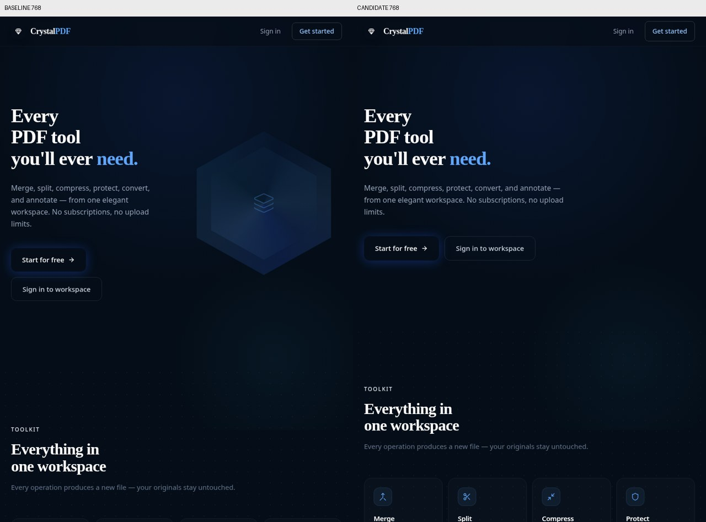
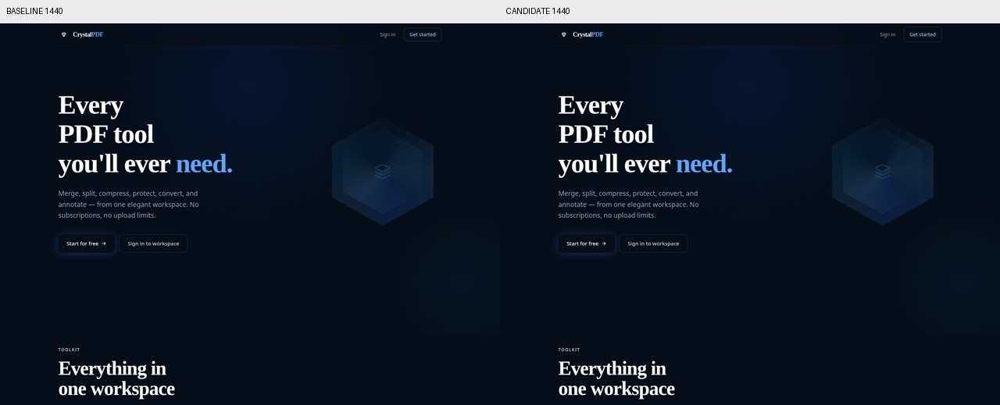

# Landing-page responsive repair and verification

Addresses the mobile landing-page request in issue #3. Tested against baseline
`0df8ff502800c0919484b05d6915e180c074821a`.

## Changes

The narrow header now places its two authentication actions below the brand,
with unbroken labels and at least 44px-high hit areas. Hero and final calls to
action are full-width and stacked below 640px. The toolkit uses one column
below 360px, two above that, and four from 640px. All eight tools and the three
workflow steps remain present.

The two-column hero and its decoration start at 1024px, leaving readable space
on tablets. `minmax(0, 1fr)` allows the text column to shrink, and only the
rotating decorative prism is clipped. The document itself does not use a
page-wide overflow-hiding rule. Reduced-motion preferences disable reveal,
fade, decorative animations, and hover movement.

## Reproduce

From `frontend`, use the existing project's Node version requirements:

```sh
npm ci
npm run build
npm run preview -- --host 127.0.0.1 --port 4173 --strictPort
```

In a second terminal, also from `frontend`:

```sh
BROWSER_PATH=/path/to/chromium npm run test:landing:browser -- candidate http://127.0.0.1:4173 ./test-results/landing
npx --no-install vitest run src/pages/LandingPage.test.tsx
npx --no-install eslint src/pages/LandingPage.tsx src/pages/LandingPage.test.tsx
```

The browser runner uses an installed Chromium-compatible browser, including
Brave or Chrome. It does not download a browser. It launches temporary isolated
contexts and closes them afterwards. Stop the preview with Ctrl+C when done.
Default browser checks block every external request so fallback-font results
are repeatable. For an additional check with the page's real display font:

```sh
LANDING_ALLOW_GOOGLE_FONTS=1 BROWSER_PATH=/path/to/chromium npm run test:landing:browser -- fonts http://127.0.0.1:4173 ./test-results/landing-fonts
```

That mode permits only fonts.googleapis.com and fonts.gstatic.com in addition
to the local app, and asserts the requested display font actually loads.

## Recorded results

See [results-summary.json](results-summary.json) for timestamps and scope.

- The original page passed 46 of the 56 browser checks; 10 failed. Failures
  included header hit-area sizes, horizontal overflow at 768/1024px, and
  reduced-motion behavior.
- The candidate production bundle passed all 56 offline-font browser checks.
- With the display font fetched, all 63 checks passed, including seven font
  load checks. This overlaps the 56-case suite; it is not 119 unique scenarios.
- All five new component/navigation tests pass. Targeted ESLint, TypeScript
  compilation, and the Vite production build pass.
- The complete frontend unit suite is NOT fully green: baseline 59 pass / 1
  fail, candidate 64 pass / 1 fail. Both have the same pre-existing
  `apiFetch > passes options to fetch` assertion, which omits the
  `credentials: 'include'` option the production helper already supplies.
  Neither the API helper nor that unrelated test has been changed.

The browser suite covers seven widths from 320 to 1440px, document overflow,
text bounds, tool visibility, auth-link destinations, mobile action stacking,
keyboard navigation, actual local navigation to registration/login, and
reduced-motion behavior. This is local Chromium verification, not a claim of
physical mobile Safari, backend functionality, or production deployment.

## Visual comparisons

Before on the left, candidate on the right. These are cropped top-of-page
comparisons from the development-server pass. The production bundle was then
rechecked with the same landing-page implementation.





## Contribution method

Implementation, test preparation and execution, and this report were
AI-assisted on behalf of William (BillTheHuman). These are measured results,
not a claim of independent manual human code review. The change was made
against the repository baseline, not copied from a competing pull request.
